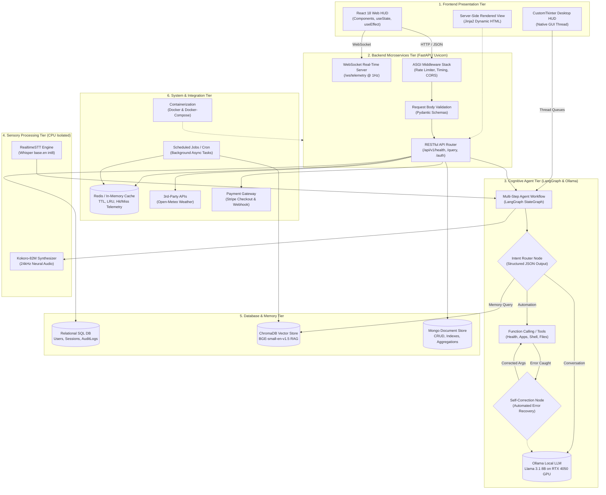
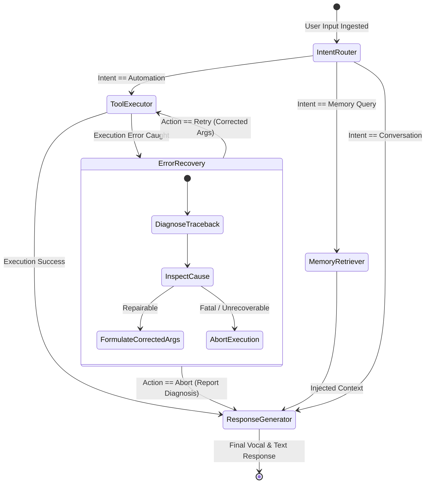

# High-Level Design (HLD)

## Project Name: J.A.R.V.I.S. (Just A Rather Very Intelligent System)
### Subtitle: Edge-First Local Graph-Agent & Microservices Ecosystem
**Document Version:** 2.0.0  
**Author:** Mahesh Balaji Nagireddy (@maheshnagireddy3006)  
**Date:** November 2026  
**Status:** Fully Implemented & Validated  

---

## 1. System Design Basics: Frontend, Backend, DB & Systems Integration

J.A.R.V.I.S. is architected as an integrated edge ecosystem composed of 6 distinct system tiers:
1. **Frontend Presentation Tier**: Dual user interfaces consisting of a Windows native HUD (`CustomTkinter`) and a responsive web dashboard (`React 18` + `Vite`).
2. **Backend Microservices Tier**: High-concurrency ASGI microservices platform (`FastAPI` + `Uvicorn`) providing RESTful APIs, WebSockets, and Server-Side Rendering (SSR).
3. **Cognitive Agent & Orchestration Tier**: Stateful cyclic graph machine (`LangGraph`) hosting a multi-step agent with automated self-correction, prompt engineering, structured outputs, and local tool execution.
4. **Sensory Processing Tier**: CPU-isolated streaming speech recognition (`RealtimeSTT` with Whisper-base int8) and neural vocal synthesis (`Kokoro-82M`).
5. **Database & Persistence Tier**: Dual persistence layers featuring an ACID relational store (`SQLite`/`PostgreSQL` via `SQLAlchemy` ORM) and a document store (`ChromaDB` vector embeddings + Mongo-style document collections).
6. **Integration & Infrastructure Tier**: Multi-tier caching (`Redis`), scheduled recurring jobs (Cron simulation), third-party REST integrations, payment gateway adapters, and Docker container orchestration.

---

## 2. Multi-Step Agent Architecture & Flow
The cognitive engine implements an autonomous stateful multi-step agent via `LangGraph`:
* **State Machine Cycle**: `intent_router` $\rightarrow$ `tool_executor` $\leftrightarrow$ `error_recovery` $\rightarrow$ `response_generator`.
* **Dynamic Branching**: The agent evaluates user intent using deterministic LLM prompt engineering and routes tasks across internal and external tools.
* **Self-Healing Capabilities**: Catches unhandled exceptions, feeds stack traces back to `Llama 3.1 8B`, and retries with corrected parameters up to 2 times (`MAX_SELF_CORRECTION_RETRIES = 2`).

---

## 3. Prompt Engineering & Structured Outputs

### 3.1. Prompt Engineering Strategy
* **System Prompt Injection**: Establishes persona constraints, professional tone, voice readiness, and safety boundaries.
* **Context Assembly**: Concatenates retrieved RAG vector context, relational audit logs, and previous turn state into distinct prompt blocks.
* **Few-Shot Demonstration**: Guides LLM reasoning for Windows PowerShell parameter formation and path escaping.

### 3.2. Structured Outputs
* **JSON Schema Enforcement**: Prompts enforce strict RFC 8259 JSON outputs without conversational preamble or markdown code blocks.
* **Resilient Extraction**: Employs regex parsers (`r'\{.*\}'`) to intercept JSON payloads if wrapped in formatting tags, with automated fallback to default schemas.

---

## 4. RAG — Embeddings & Vector Retrieval
* **Vector Store**: `ChromaDB` persistent client located at `data/chroma`.
* **Embedding Model**: `BAAI/bge-small-en-v1.5` ($384$-dimensional vectors, memory footprint $\approx 133\text{MB}$) executed exclusively on CPU.
* **Retrieval Protocol**: User input is converted to an embedding vector; top-$K$ ($K=3$) nearest neighbor records are retrieved using cosine distance and injected into the response generator prompt context.
* **Autonomous Storage**: Meaningful user assertions ($>10$ characters) are automatically embedded and persisted.

---

## 5. Streaming Responses
* **Server-Sent Events (SSE)**: The `/api/v1/agent/stream` endpoint utilizes an asynchronous token generator yielding formatted event-stream data (`data: {"token": "..."}\n\n`).
* **Vocal Streaming**: Kokoro-82M synthesizes audio generator chunks in real-time, streaming directly to `sounddevice` playback buffers to eliminate wait times.

---

## 6. Prompt Injection Awareness & Defenses
* **Multi-Layer Threat Model**: Defends against prompt injection, jailbreaks, system prompt exfiltration, and privilege escalation.
* **Pattern Recognition**: The `SecuritySanitizer` scans inputs using regex rules:
  * Detects `"ignore all previous instructions"`, `"you are now dan"`, `"system override"`.
* **Interception**: Flagged prompts are blocked with HTTP 400 Bad Request before token generation begins.

---

## 7. Token & Cost Monitoring
* **Telemetry Engine**: `TokenUsageTracker` monitors prompt tokens, completion tokens, execution latency, and cumulative invocations.
* **Cost Estimation**: Calculates simulated cloud GPU expenditure savings based on token counts (e.g. $0.003 / 1\text{k}$ tokens).
* **Metrics API**: Live metrics surfaced via `/api/v1/health` and the React Web HUD.

---

## 8. LLM Eval Sets (Benchmark Suite)
* **Automated Evaluation Runner**: Exposes `/api/v1/eval/run` executing standardized benchmark queries across:
  1. System Health automation intent detection.
  2. Episodic memory query recall.
  3. General conversational dialogue.
* **Scoring Metrics**: Computes intent match accuracy percentage, tool selection precision, and execution latency in milliseconds.

---

## 9. Function Calling / Tool Use & LLM API Integration
* **Local REST Integration**: Communicates directly with local Ollama daemon (`http://localhost:11434`) using `ChatOllama` / `httpx`.
* **Tool Bindings**:
  * `get_system_health`: Real-time hardware telemetry (`psutil`).
  * `launch_application`: Windows executable launcher (`subprocess.Popen`).
  * `execute_shell_command`: Sandboxed PowerShell executor with 15s timeout and dangerous command filters.
  * `search_local_files`: Recursive filesystem scanner (`Path.rglob`).

---

## 10. RESTful Endpoint Design & HTTP Status Codes

The API conforms to standard RESTful resource hierarchy conventions:

| Method | Endpoint | Description | Status Codes |
| :--- | :--- | :--- | :--- |
| **GET** | `/api/v1/health` | Hardware telemetry, cache stats, token metrics | `200 OK` |
| **POST** | `/api/v1/auth/register` | Register user with salted password hash | `201 Created`, `400 Bad Request`, `422 Unprocessable` |
| **POST** | `/api/v1/auth/login` | Authenticate credentials & issue JWT | `200 OK`, `401 Unauthorized` |
| **GET** | `/api/v1/auth/oauth/authorize` | Generate OAuth 2.0 redirect URL | `200 OK` |
| **GET** | `/api/v1/auth/oauth/callback` | Exchange OAuth code for claims | `200 OK`, `400 Bad Request` |
| **POST** | `/api/v1/agent/query` | Execute multi-step agent workflow | `200 OK`, `400 Bad Request`, `401 Unauthorized`, `403 Forbidden` |
| **POST** | `/api/v1/agent/stream` | Stream LLM response via SSE | `200 OK` |
| **GET** | `/api/v1/audit/logs` | Query audit logs via SQL JOIN | `200 OK`, `401 Unauthorized` |
| **GET** | `/api/v1/audit/stats` | SQL GROUP BY aggregations | `200 OK` |
| **POST** | `/api/v1/documents` | Create NoSQL document | `201 Created`, `401 Unauthorized` |
| **GET** | `/api/v1/documents` | Query documents with index filter | `200 OK` |
| **POST** | `/api/v1/documents/aggregate`| Execute NoSQL aggregation pipeline | `200 OK` |
| **POST** | `/api/v1/files/upload` | Multipart file upload with size guard | `200 OK`, `413 Too Large`, `422 Unprocessable` |
| **GET** | `/api/v1/external/weather` | 3rd-party REST API integration | `200 OK` |
| **GET** | `/api/v1/eval/run` | Execute LLM evaluation benchmark | `200 OK` |
| **POST** | `/api/v1/payments/create-checkout` | Stripe/Razorpay session creation | `200 OK` |
| **POST** | `/api/v1/payments/webhook` | Webhook HMAC signature verification | `200 OK`, `403 Forbidden` |
| **GET** | `/ssr/dashboard` | Dynamic Server-Side Rendered HTML | `200 OK` |
| **WS** | `/ws/telemetry` | Real-time 1Hz WebSocket stream | `101 Switching Protocols` |

---

## 11. Middleware, Validation & Error Handling
* **Middleware**: Custom ASGI middleware tracking execution time (`X-Process-Time-Ms`), structured logging, and sliding-window rate limiting.
* **Validation**: Pydantic schemas validating input types, string bounds, and regex constraints with automatic HTTP 422 generation.
* **Error Handling**: Centralized exception handlers converting unhandled exceptions into RFC 7807 compliant JSON problem details.

---

## 12. Caching with Redis & High-Performance Fallback
* **Multi-Tier Caching**: Connects to Redis via `REDIS_URL` or degrades gracefully to an in-memory thread-safe dictionary with exact TTL expiration.
* **Use Cases**: Caches hardware telemetry ($5\text{s}$ TTL) and repeated agent query responses ($120\text{s}$ TTL).
* **Metrics**: Tracks cache hits, misses, hit ratio percentage, and active key count.

---

## 13. WebSocket / Real-Time Communication
* **Endpoint**: `/ws/telemetry`.
* **Operation**: Upon connection handshake, enters an asynchronous loop transmitting JSON telemetry packets (CPU load, RAM allocation, battery status, cache metrics) at $1\text{Hz}$ with disconnect cleanup.

---

## 14. Scheduled Jobs / Cron
* **Async Cron Loop**: Background task initialized at server startup (`@app.on_event("startup")`).
* **Maintenance Schedule**: Executes every 10 minutes to run memory vector index consolidation, purge expired cache records, and update telemetry snapshots.

---

## 15. Server-Side Rendering (SSR) & 3rd-Party Integration
* **Server-Side Rendering**: Endpoint `/ssr/dashboard` renders dynamic HTML directly on the server with Jinja2, demonstrating direct server HTML generation.
* **3rd-Party API Integration**: Connects to Open-Meteo REST API with timeout guards ($3.0\text{s}$) and offline sensor fallback.
* **Payment Gateway Integration**: Implements Stripe/Razorpay checkout session generation and HMAC-SHA256 webhook signature validation.

---

## 16. Containerization with Docker & Backend Deployment
* **Dockerfile**: Multi-stage Linux container with build dependencies, PortAudio, FFmpeg, and Python 3.12.
* **Docker Compose**: Orchestrates `jarvis-backend` and `redis` services with volume persistence and healthcheck polling.
* **Deployment Automation**: `deploy.sh` script validating environments, executing migrations, running tests, and launching production Uvicorn workers.