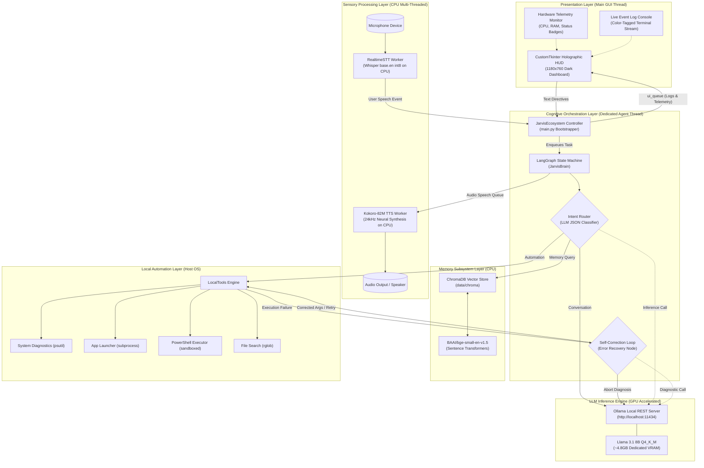
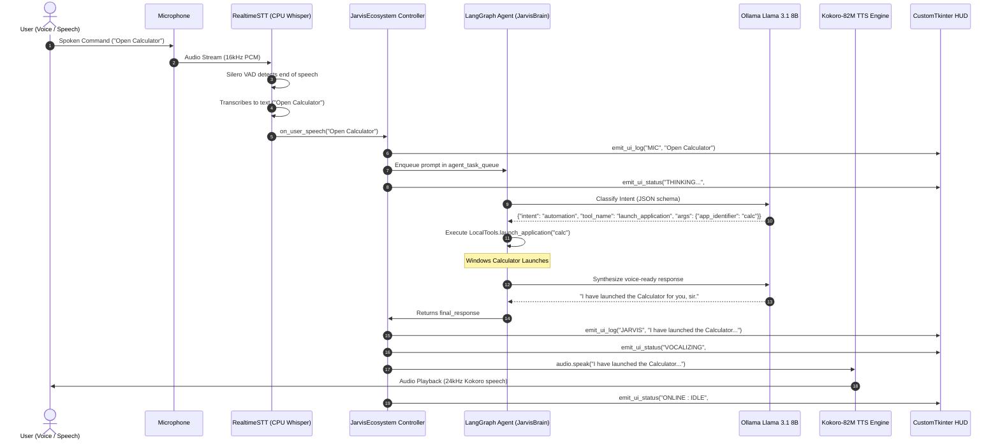

# High-Level Design (HLD)

## Project Name: J.A.R.V.I.S. (Just A Rather Very Intelligent System)
### Subtitle: Edge-First Local Graph-Agent Desktop Ecosystem
**Document Version:** 1.0.0  
**Author:** Mahesh Balaji Nagireddy (@maheshnagireddy3006)  
**Date:** November 2026  
**Status:** Implemented & Validated  

---

## 1. System Architecture Overview
J.A.R.V.I.S. is engineered with a modular, decoupled, edge-first architecture. It combines a stateful graph agent (`LangGraph`), local neural inference (`Ollama`), persistent vector embeddings (`ChromaDB`), neural sensory processing (`RealtimeSTT` & `Kokoro-82M`), and a futuristic desktop dashboard (`CustomTkinter`).

The architecture strictly adheres to three fundamental engineering principles:
1. **Asymmetric Compute Partitioning**: Dedicating the discrete GPU exclusively to the large-parameter LLM, while strictly binding sensory speech processing, vector embeddings, and OS tools to multi-threaded CPU cores to prevent VRAM saturation and out-of-memory crashes.
2. **Asynchronous Non-Blocking Concurrency**: Isolating GUI event handling, audio streaming, and neural reasoning across independent OS threads coordinated by thread-safe FIFO queues (`queue.Queue`).
3. **Closed-Loop Self-Healing Orchestration**: Structuring tool execution within a cyclic directed graph where execution faults trigger autonomous LLM-driven root cause diagnosis and dynamic argument correction.



---

## 2. Hardware Resource Partitioning Strategy

| Hardware Resource | Dedicated Subsystem | Allocation / Constraints | Rationale |
| :--- | :--- | :--- | :--- |
| **GPU (Nvidia RTX 4050 6GB GDDR6)** | Ollama LLM (`llama3.1:8b`) | **$\le 4.9\text{ GB}$ VRAM** (Reserved 100% for LLM) | Prevents GPU VRAM paging and out-of-memory crashes when concurrent audio and embedding pipelines execute. |
| **CPU (Intel i5-13450HX 10C / 16T)** | Sensory Pipelines, Memory & Agent | **8 Dedicated Worker Threads** (`OMP_NUM_THREADS=8`) | Whisper-int8 and Kokoro-82M are optimized for modern AVX2 CPU instructions without competing with GPU shaders. |
| **System RAM (24GB DDR5)** | OS, Python Host & ChromaDB | **$\approx 3.2\text{ GB}$ Active Footprint** | Low system memory overhead leaves ample headroom for multitasking during complex automation. |

---

## 3. Subsystem Deconstruction

### 3.1. Presentation Layer (CustomTkinter HUD)
* **Module**: `ui_panel.py` (`JarvisUIPanel` class)
* **Execution Context**: Windows Native Main Thread.
* **Responsibilities**:
  * Renders a 1180x760 holographic dark cockpit panel with cyan (`#00e5ff`) accents and deep slate backgrounds (`#070b12`).
  * Polls `ui_queue` every $50\text{ms}$ (`self.after(50, ...)`) to consume log tuples `(tag, message)` and status updates `(status_text, color_hex)` from background threads without blocking.
  * Polls system hardware metrics every $1000\text{ms}$ (`psutil`) to update CPU progress bars, RAM percentage, and peripheral indicators.
  * Provides an interactive command bar supporting Enter-to-submit, microphone mute toggling, and quick system health diagnostics.

### 3.2. Sensory Processing Layer (Audio Engine)
* **Module**: `audio_engine.py` (`AudioEngine`, `RealtimeSTTListener`, `KokoroTTS` classes)
* **Execution Context**: Two dedicated OS threads (`JarvisSTTWorker`, `JarvisTTSWorker`) plus RealtimeSTT background reader processes.
* **Responsibilities**:
  * **Speech-to-Text**: Uses `RealtimeSTT` wrapping `faster-whisper` (`base.en` model, `int8` compute type) with Silero VAD. Listens continuously, segments vocal pauses ($1.0\text{s}$ post-speech silence window), transcribes speech into text, and dispatches the prompt to `JarvisEcosystem.handle_user_input`.
  * **Text-to-Speech**: Employs `Kokoro-82M` (KPipeline, American English `af_heart` voice) at $24\text{kHz}$ sampling rate. Streams synthesized audio chunks to `sounddevice` output buffers.
  * **Fallback Handling**: If Kokoro fails or is uninitialized, the engine safely degrades to Windows SAPI-based `pyttsx3` offline speech synthesis.

### 3.3. Cognitive Orchestration Layer (Jarvis Brain)
* **Module**: `brain.py` (`JarvisBrain`, `JarvisState`, `MemorySubsystem`, `LocalTools`)
* **Execution Context**: Dedicated worker thread (`JarvisAgentWorker`).
* **Graph Topology**:
  * **State Graph**: Manages transitions between 5 nodes: `intent_router`, `tool_executor`, `error_recovery`, `memory_retriever`, and `response_generator`.
  * **Intent Router**: Invokes Llama 3.1 8B with a structured JSON schema to categorize user directives into `automation`, `memory_query`, or `conversation`.
  * **Self-Correction Engine**: If tool execution encounters an unhandled exception or non-zero subprocess return code, execution routes to `error_recovery`. The error traceback, original user prompt, and failed parameters are evaluated by Llama 3.1 8B to deduce the root cause and generate corrected parameters for an immediate retry.

### 3.4. Memory Subsystem Layer
* **Module**: `brain.py` (`MemorySubsystem` class)
* **Persistence Location**: `data/chroma/` (Embedded SQLite3 database + HNSW index)
* **Responsibilities**:
  * Uses `chromadb.PersistentClient` with `BAAI/bge-small-en-v1.5` embeddings on CPU.
  * Stores conversational snippets and operational facts.
  * Performs semantic top-$K$ ($K=3$) cosine-similarity queries to inject relevant episodic memory records into the response generation context.

### 3.5. Host Automation & Tool Layer
* **Module**: `brain.py` (`LocalTools` class)
* **Capabilities**:
  * `get_system_health()`: Gathers CPU load, core topology, RAM metrics, partition disk usage, and battery state.
  * `launch_application(app_identifier)`: Resolves application aliases (e.g., `calc`, `notepad`, `terminal`, `code`, `chrome`) and executes them via `subprocess.Popen` or `os.startfile`.
  * `execute_shell_command(command)`: Runs non-interactive PowerShell processes with timeout guards ($15\text{s}$) and dangerous command filters (blocking destructive disk formatting or file removal).
  * `search_local_files(directory, pattern)`: Recursively scans local workspaces matching wildcard patterns, capped at 15 matches to avoid context bloating.

---

## 4. End-to-End Sequence Workflows

### 4.1. Voice Query to Vocal Response Workflow



### 4.2. Autonomous Self-Correction Workflow

```mermaid
flowchart TD
    Start([User Request Ingested]) --> Router[Node: intent_router]
    Router -->|"intent: automation"| ToolExec[Node: tool_executor]
    
    ToolExec --> ExecuteTool{Execute LocalTool}
    ExecuteTool -->|Success| RespGen[Node: response_generator]
    ExecuteTool -->|Exception / Error Code| ErrCheck{Retry Count < 2?}

    ErrCheck -->|Yes| Recovery[Node: error_recovery]
    ErrCheck -->|No (Exhausted)| FatalErr[Node: response_generator\nReport Fatal Error]

    subgraph Self_Healing_Loop ["Autonomous Self-Correction Sub-Graph"]
        Recovery --> AnalyzePrompt[Prompt Llama 3.1 8B with:\n- Failed Tool Name\n- Input Arguments\n- Python Stack Trace / OS Error]
        AnalyzePrompt --> LLMDiagnosis{LLM Diagnosis}
        LLMDiagnosis -->|"action: retry (Corrected Args)"| ToolExec
        LLMDiagnosis -->|"action: abort (Unrecoverable)"| FatalErr
    end

    RespGen --> FinalResponse([Vocalize & Display Response])
    FatalErr --> FinalResponse
```

---

## 5. Inter-Process & Inter-Thread Synchronization

The application relies on decoupled queue architectures to avoid race conditions and UI lockups:

1. **`ui_queue` (`queue.Queue`)**:
   - Dispatches tuples `("log", (tag, message))` and `("status", (status_text, color_hex))`.
   - Read exclusively by the UI thread via `JarvisUIPanel._process_queue()` scheduled via Tkinter `after()` callbacks.
2. **`agent_task_queue` (`queue.Queue`)**:
   - Buffers incoming user queries from voice transcription or GUI text submissions.
   - Read exclusively by `JarvisAgentWorker` thread with a 500ms polling timeout.
3. **`speech_queue` (`queue.Queue`)**:
   - Buffers plain text sentences waiting for neural vocal synthesis.
   - Read exclusively by `JarvisTTSWorker` to guarantee uninterrupted audio streaming.

---

## 6. Safety Guardrails & Failure Modes

* **Destructive Shell Command Guard**: PowerShell commands are filtered against a blacklist containing `format`, `del /f /s /q c:`, `rmdir /s /q c:`, and `reg delete`.
* **Execution Timeout Guard**: Shell operations enforce an explicit `timeout=15` seconds to prevent hung background processes.
* **Ollama Connection Resilience**: If the Ollama daemon is unreachable or returns an HTTP error, the response generator catches the network exception and degrades gracefully with a polite user-facing error message.
* **Microphone Mute State**: A global thread-safe flag (`is_muted`) in `RealtimeSTTListener` suppresses speech ingestion without halting audio recording hardware.