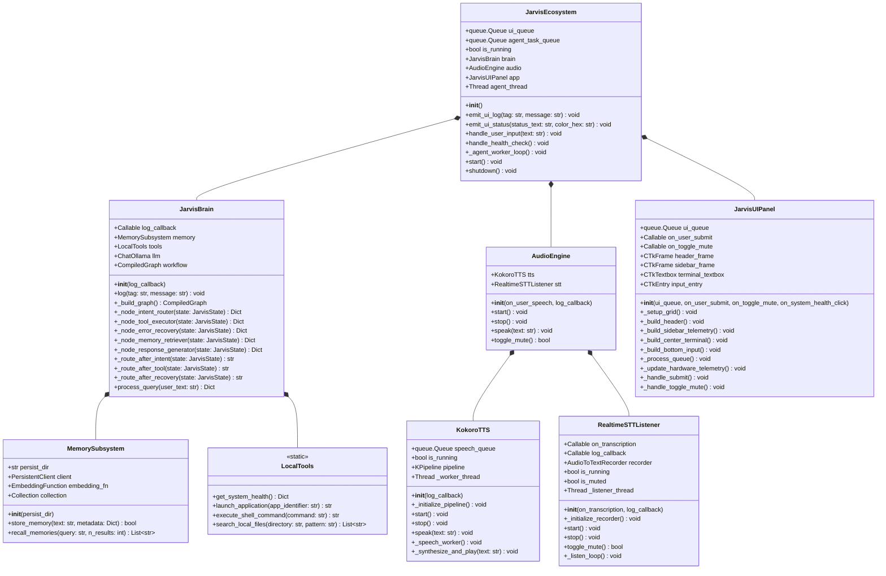

# Low-Level Design (LLD)

## Project Name: J.A.R.V.I.S. (Just A Rather Very Intelligent System)
### Subtitle: Edge-First Local Graph-Agent Desktop Ecosystem
**Document Version:** 1.0.0  
**Author:** Mahesh Balaji Nagireddy (@maheshnagireddy3006)  
**Date:** November 2026  
**Status:** Implemented & Validated  

---

## 1. Codebase Architecture & File Structure

```
d:\Jarvis_core\
├── .vscode/
│   └── settings.json          # Python interpreter path and analysis bindings
├── data/
│   ├── chroma/                # Persistent vector database (SQLite3 + HNSW indexes)
│   └── logs/                  # System operational logs
├── jarvis_env/                # Local Python 3.12 virtual environment
├── audio_engine.py            # STT (RealtimeSTT Whisper) & TTS (Kokoro-82M) pipelines
├── brain.py                   # LangGraph state machine, ChromaDB, & LocalTools
├── config.py                  # Global hardware configuration, constants, & themes
├── main.py                    # Ecosystem bootstrapper & multi-threaded coordinator
├── pyrightconfig.json         # Static typing and language server configuration
├── realtimesst.log            # STT engine runtime logs
├── requirements.txt           # Strict dependency pinning
├── run_jarvis.bat             # Windows one-click initialization batch launcher
├── ui_panel.py                # CustomTkinter holographic sci-fi desktop HUD
├── PRD.md                     # Product Requirements Document
├── HLD.md                     # High-Level Design Document
└── LLD.md                     # Low-Level Design Document
```

---

## 2. Class & Component Diagram



---

## 3. Data Schemas & State Specifications

### 3.1. LangGraph State Schema (`JarvisState`)
Defined as a `TypedDict` in `brain.py`:

```python
class JarvisState(TypedDict):
    user_input: str                 # The raw text prompt received from STT or GUI input
    messages: List[Dict[str, str]]  # Accumulated multi-turn conversational message history
    intent: str                     # Classified intent: 'automation' | 'memory_query' | 'conversation'
    tool_name: Optional[str]        # Target tool name if intent is 'automation'
    tool_args: Optional[Dict[str, Any]] # Extracted parameters for the designated tool
    tool_result: Optional[str]      # JSON or plain-text string output returned by the tool
    error_trace: Optional[str]      # Formatted exception traceback if a tool execution fails
    retry_count: int                # Number of self-correction attempts (0 to 2)
    memory_context: Optional[str]   # Vector-retrieved memory snippets injected as context
    final_response: str             # Final response synthesized for vocalization and UI display
```

### 3.2. Thread-Safe UI Queue Contracts (`ui_queue`)
Events pushed by background threads into `self.ui_queue` follow strict tuple signatures:

* **Log Message Event**:
  ```python
  ("log", (tag: str, message: str))
  # Example tags: "SYSTEM", "JARVIS", "MIC", "ROUTER", "TOOL", "SUCCESS", "RETRY", "ERROR", "WARN"
  ```
* **Status Badge Event**:
  ```python
  ("status", (status_text: str, color_hex: str))
  # Example: ("ONLINE : IDLE", "#00ff88"), ("THINKING...", "#00e5ff"), ("VOCALIZING", "#00ff88")
  ```

### 3.3. ChromaDB Episodic Memory Schema
* **Collection Name**: `jarvis_episodic_memory`
* **Embedding Model**: `BAAI/bge-small-en-v1.5` ($384$ dimensional vectors)
* **Document Text**: Formatted interaction string, e.g.:
  `"User stated: <user_input> | Jarvis action/reply: <final_text[:120]>"`
* **Metadata Dict**:
  * `source`: String identifier (`"session_stream"` or `"conversation"`).
  * `timestamp`: Unix floating-point epoch time (`time.time()`).
* **Document ID**: Unique key string `f"mem_{int(time.time() * 1000)}"`.

---

## 4. State Machine Node Execution Logic

### 4.1. Intent Router Node (`_node_intent_router`)
1. **Input**: `state["user_input"]`.
2. **Execution**:
   * Prepares a system prompt instructing the LLM to output strictly valid JSON conforming to:
     ```json
     {
       "intent": "automation" | "memory_query" | "conversation",
       "tool_name": "get_system_health" | "launch_application" | "execute_shell_command" | "search_local_files" | null,
       "tool_args": { ... }
     }
     ```
   * Invokes `self.llm.invoke([SystemMessage(...), HumanMessage(...)])`.
   * Applies regex pattern `r'\{.*\}'` to extract the JSON block, defending against markdown wrappers.
   * Parses JSON with fallback to `intent = "conversation"` upon parsing errors.
3. **Output**: Updated state dictionary containing `intent`, `tool_name`, `tool_args`, `error_trace=None`, and `retry_count=0`.

### 4.2. Tool Executor Node (`_node_tool_executor`)
1. **Input**: `state["tool_name"]`, `state["tool_args"]`.
2. **Branching**:
   * `"get_system_health"` $\rightarrow$ calls `LocalTools.get_system_health()`, serializes to JSON.
   * `"launch_application"` $\rightarrow$ passes `app_identifier` to `LocalTools.launch_application()`.
   * `"execute_shell_command"` $\rightarrow$ passes `command` to `LocalTools.execute_shell_command()`.
   * `"search_local_files"` $\rightarrow$ calls `LocalTools.search_local_files(directory, pattern)`.
3. **Exception Interception**:
   * If an exception occurs, formats the full traceback via `traceback.format_exc()`.
   * Sets `tool_result = None` and `error_trace = f"{str(e)}\n{tb}"`.
4. **Output**: Updated state with either `tool_result` (on success) or `error_trace` (on failure).

### 4.3. Error Recovery Node (`_node_error_recovery`)
1. **Input**: `state["tool_name"]`, `state["error_trace"]`, `state["tool_args"]`, `state["retry_count"]`.
2. **Logic**:
   * Increments `retry_count += 1`.
   * Formulates a diagnostic meta-prompt presenting the stack trace and Windows 11 host environment context to Llama 3.1 8B.
   * Requests a structured remediation response:
     * If repairable: `{"action": "retry", "tool_args": { ...corrected parameters... }}`.
     * If unrecoverable: `{"action": "abort", "diagnosis": "<root cause summary>"}`.
3. **Output**:
   * If retry: updates `tool_args` with corrected values and resets `error_trace = None`.
   * If abort: updates `tool_result` with failure diagnosis to inform the response generator.

### 4.4. Memory Retriever Node (`_node_memory_retriever`)
1. **Input**: `state["user_input"]`.
2. **Execution**:
   * Calls `self.memory.recall_memories(user_input, n_results=config.MEMORY_QUERY_TOP_K)`.
   * Queries ChromaDB using cosine distance over BGE embeddings.
   * Formats retrieved documents into a newline-separated context string.
3. **Output**: `{"memory_context": context}`.

### 4.5. Response Generator Node (`_node_response_generator`)
1. **Input**: `user_input`, `tool_result`, `memory_context`, `error_trace`.
2. **Execution**:
   * Builds context blocks from available tool results, memory context, and error notices.
   * Prompts Llama 3.1 8B under the persona of JARVIS (concise, professional, witty, voice-ready).
   * Generates final text response.
   * Asynchronously stores interactions with meaningful content ($>10$ characters) into vector memory.
3. **Output**: `{"final_response": final_text}`.

---

## 5. Conditional Edge Routing Specifications

```python
def _route_after_intent(self, state: JarvisState) -> str:
    intent = state.get("intent", "conversation")
    if intent == "automation" and state.get("tool_name"):
        return "automation"          # Directs to 'tool_executor'
    elif intent == "memory_query":
        return "memory_query"        # Directs to 'memory_retriever'
    return "conversation"            # Directs to 'response_generator'

def _route_after_tool(self, state: JarvisState) -> str:
    if state.get("error_trace") is None:
        return "success"             # Directs to 'response_generator'
    if state.get("retry_count", 0) < config.MAX_SELF_CORRECTION_RETRIES:
        return "error_recover"       # Directs to 'error_recovery'
    return "fatal_error"             # Directs to 'response_generator' (aborted)

def _route_after_recovery(self, state: JarvisState) -> str:
    if state.get("error_trace") is None and state.get("tool_args") is not None:
        return "retry_tool"          # Loops back to 'tool_executor'
    return "abort_to_response"       # Directs to 'response_generator'
```

---

## 6. Detailed Tool Execution Implementation

### 6.1. System Health Telemetry (`get_system_health`)
* **CPU Sampling**: `psutil.cpu_percent(interval=0.1)`, `psutil.cpu_count(logical=True/False)`.
* **RAM Sampling**: Total GB, Used GB, Percent via `psutil.virtual_memory()`.
* **Disk Sampling**: Iterates all mount points via `psutil.disk_partitions(all=False)`, extracting Total GB, Free GB, and Percent Used via `psutil.disk_usage()`.
* **Battery Sampling**: Detects percentage, AC power plug status, and discharge time via `psutil.sensors_battery()`.

### 6.2. Application Launcher (`launch_application`)
* **Alias Normalization Dictionary**:
  `"calc"` / `"calculator"` $\rightarrow$ `calc.exe`  
  `"notepad"` $\rightarrow$ `notepad.exe`  
  `"terminal"` $\rightarrow$ `wt.exe`  
  `"chrome"` $\rightarrow$ `chrome.exe`  
  `"edge"` $\rightarrow$ `msedge.exe`  
  `"explorer"` $\rightarrow$ `explorer.exe`  
  `"code"` $\rightarrow$ `code.cmd`  
* **Execution Path**: Resolves target via `shutil.which()` or direct path; executes asynchronously with `subprocess.Popen(target, shell=True)` or `os.startfile()`.

### 6.3. Sandboxed Shell Execution (`execute_shell_command`)
* **Security Filter**: Blacklists destructive patterns (`"format"`, `"del /f /s /q c:"`, `"rmdir /s /q c:"`, `"reg delete"`).
* **Subprocess Configuration**:
  ```python
  subprocess.run(
      ["powershell.exe", "-NoProfile", "-NonInteractive", "-Command", command],
      capture_output=True,
      text=True,
      encoding="utf-8",
      errors="replace",
      timeout=15,
      check=False
  )
  ```
* **Error Semantics**: Non-zero return codes raise `RuntimeError` capturing `stderr` for self-correction processing.

---

## 7. Sensory Pipeline Implementation

### 7.1. Speech-to-Text (`RealtimeSTTListener`)
* **Initialization Parameters**:
  * `model`: `"base.en"`
  * `device`: `"cpu"`
  * `compute_type`: `"int8"`
  * `silero_sensitivity`: `0.4`
  * `post_speech_silence_duration`: `1.0` seconds
  * `wake_words`: `""` (Continuous listening loop)
* **Worker Execution**: Background loop reads completed text phrases from `self.recorder.text()` and dispatches clean text to the ecosystem callback `on_transcription(clean_text)`.

### 7.2. Neural Text-to-Speech (`KokoroTTS`)
* **Pipeline Setup**: `kokoro.KPipeline(lang_code="a", device="cpu")`.
* **Voice Profile**: `"af_heart"` at $24\text{kHz}$ sampling rate.
* **Streaming Playback**: Synthesizes audio generator chunks `(_, _, audio)` and writes directly to `sounddevice.play(audio, config.TTS_SAMPLE_RATE)`.

---

## 8. User Interface Implementation

* **Root Widget**: `customtkinter.CTk` window configured with dark appearance mode.
* **Layout Grid**:
  * Row 0: Top Header status bar ($65\text{px}$ height).
  * Row 1: Split body — Left Telemetry Sidebar ($260\text{px}$ width) + Right Terminal Log Console.
  * Row 2: Bottom Command Bar ($70\text{px}$ height) with voice visualizer and input entry.
* **UI Event Dispatch Loop**:
  ```python
  def _process_queue(self):
      while not self.ui_queue.empty():
          msg_type, payload = self.ui_queue.get_nowait()
          if msg_type == "log":
              self._append_log_line(payload[0], payload[1])
          elif msg_type == "status":
              self._update_status_badge(payload[0], payload[1])
      self.after(50, self._process_queue)
  ```